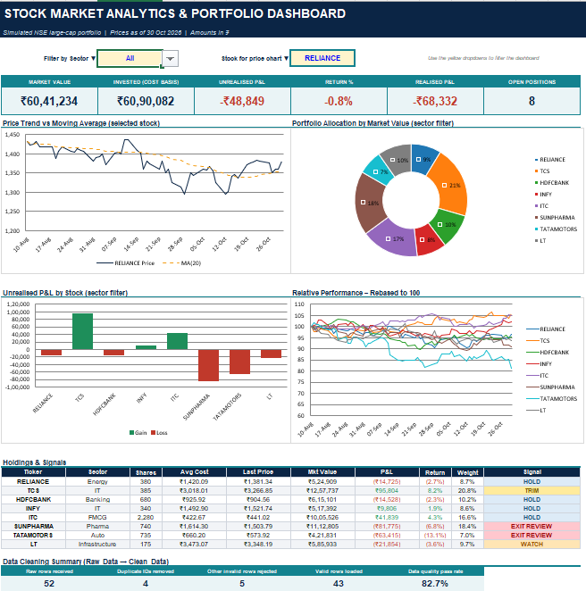

# 📈 Stock Market Analytics & Portfolio Dashboard

**From messy transaction exports to executive-ready portfolio insights, built entirely in Excel.**

## 🎯 Overview
Raw trading data is rarely clean. This project takes a messy transaction export with mixed
casing, stray spaces, text-formatted numbers, text dates, duplicate IDs and invalid rows. It
cleans the data automatically, calculates portfolio performance, and presents it in an
interactive dashboard that supports quick buy / hold / exit decisions.

## ✨ Key Features
| | Feature | Details |
|---|---|---|
| 🧹 | **Automated data cleaning** | 52 raw rows → 43 validated (82.7% pass rate). Duplicates and invalid rows are detected and rejected with a reason |
| 🧠 | **Nested logical signals** | Rule-based engine: `EXIT REVIEW → TRIM → HOLD-WINNER → WATCH → HOLD` |
| 🗺️ | **Conditional matrix mapping** | Return × Trend position map that auto-populates tickers, plus an 8×8 correlation heatmap |
| 🎛️ | **Interactive filters** | Sector and stock dropdowns update KPIs and charts instantly |
| 📊 | **Visual analytics** | Price vs moving average, allocation doughnut, P&L by stock, rebased performance |
| ✅ | **Built-in reconciliation** | Cash invested ties out to cost basis + realised P&L |

## 🗂️ Workbook Structure
| Sheet | Purpose |
|---|---|
| **Dashboard** | KPI cards, charts, holdings & signals, data-quality summary |
| **Portfolio** | Shares, average cost, market value, unrealised & realised P&L, weights |
| **Matrix** | Return × Trend map, correlation heatmap, signal legend |
| **Raw_Data** | Messy export as received |
| **Clean_Data** | Standardised and validated transactions (Excel Table) |
| **Prices / Returns** | 60-day price history and daily returns |
| **Setup** | Editable thresholds (stop-loss, profit target, max weight) and methodology |

## 🛠️ Excel Skills Demonstrated
`SUMIFS` · `COUNTIFS` · `INDEX / MATCH` · nested `IF` · `TRIM` / `UPPER` / `PROPER` · `VALUE` / `DATEVALUE` ·
`CORREL` · rolling `AVERAGE` · Data Validation dropdowns · Conditional Formatting ·
Excel Tables · Dynamic charts

## 🚀 How to Use
1. Download `Stock_Market_Analytics_Portfolio_Dashboard.xlsx`
2. Open it in Microsoft Excel
3. Use the **yellow dropdowns** on the Dashboard to filter by sector or stock
4. Change thresholds in **Setup** to see the signals update
5. To adapt it: replace the data in **Raw_Data** and **Prices**, keeping the same column layout (extend the formula rows in Clean_Data if you add more transactions)

## ⚠️ Data Disclaimer
All prices and transactions are **simulated** for demonstration purposes. Nothing here is
investment advice.

## 👤 Author
**Diksha Mishra** · [LinkedIn](https://www.linkedin.com/in/dikshamishra2004/) · [GitHub](https://github.com/dikshamishra2004)

⭐ If you found this useful, please star the repo!
